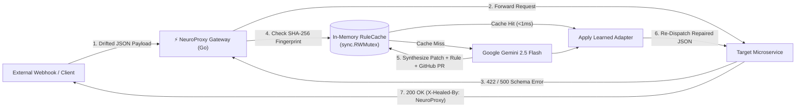

# ⚡ NeuroProxy — Autonomous Self-Healing API Gateway

> **Google Cloud AI Builder Cup 2026 Submission** — Team **Zenith Systems**  
> **Track:** Future of Work & Enterprise Productivity *(Autonomous Developer Infrastructure & SRE)*  
> **Stack:** Go 1.23 (`net/http`, `sync.RWMutex`), Google Gemini (`gemini-2.5-flash`), Next.js 15 / React 19 / Tailwind CSS v4, Google Cloud Run

> [!IMPORTANT]
> **👋 Team Zenith Systems Onboarding (Start Here):**
> * **Master Execution Plan & Timeline:** See [`PLAN.md`](./PLAN.md)
> * **Official Pitch Deck Slide Copy & Portal Text:** See [`PITCH_DECK_OUTLINE.md`](./PITCH_DECK_OUTLINE.md)
> * **Run Locally in 10 Seconds:** Copy `.env.example` to `.env.local`, add your `GEMINI_API_KEY` from [Google AI Studio](https://aistudio.google.com/apikey), run `go run .`, and open **`http://localhost:8080`**.

---

## 1. The Problem: Schema Drift & 3:00 AM Outages

Modern distributed architectures rely on dozens of external webhooks (Stripe, Shopify, logistics ERPs) and client applications. When an upstream provider renames a JSON field (`amount_cents` $\rightarrow$ `payment.amount_dollars`), nests an object (`customer_email` $\rightarrow$ `buyer.contact.email`), or changes a type/enum without warning:
1. Downstream microservices throw unhandled **`422 Unprocessable Entity` / `500 Internal Server Error`** exceptions.
2. Customer checkouts and critical industrial telemetry drop on the floor.
3. On-call SREs are paged at 3:00 AM to manually inspect logs, write hotfix adapters, and redeploy containers.

---

## 2. The Solution: Autonomous Runtime Self-Healing

**NeuroProxy** is an ultra-light reverse proxy deployed on **Google Cloud Run** that sits in front of backend microservices and eliminates schema-drift downtime autonomously:



### Key Engineering Capabilities (v2.0)
* **Real-Time Interception:** Holds the client HTTP connection open when a downstream microservice rejects a payload (`400`/`409`/`422`/`500`).
* **Multi-Turn Agentic Self-Correction Loop:** When an upstream service validates in layers (e.g., Layer 1 JSON Schema Unmarshaler $\rightarrow$ Layer 2 Domain/AML Compliance Engine), NeuroProxy catches the secondary `409 Conflict` error on retry, feeds the new domain trace back into **Gemini 2.5 Flash (Turn 2)**, and resolves multi-layer failures autonomously in a single HTTP trip.
* **🛡️ Zero-Hallucination Value Conservation Guardrail:** Before re-dispatching any LLM-repaired payload, a deterministic Go verifier ([`VerifyValueConservation`](./internal/proxy/guardrail.go)) proves mathematically that 100% of target scalars (amounts, IDs, emails, SKUs, sensor readings) trace directly to source leaf nodes. If a corrupted webhook is missing a critical field (like price) and an LLM attempts to invent a number, NeuroProxy triggers a **`SAFETY_VETO`** and blocks the request.
* **Sub-Millisecond In-Memory Rule Cache (`0ms` LLM Cost on Repeat Traffic):** Computes a structural `SHA-256` fingerprint of the incoming JSON keys and types. Once Gemini heals a drifted schema once, the learned transformation rule is stored in a thread-safe `sync.RWMutex` cache—healing 10,000+ subsequent requests in **`<0.2ms` without calling the LLM**.
* **1-Click Standalone Go Middleware Export & GitHub PR Diff:** Generates both a unified Git diff (`--- a/internal/handlers/...`) and a downloadable, zero-dependency Go middleware file (`/api/export/middleware.go`) containing all compiled `SHA-256` rules.

---

## 3. Repository Structure

```text
neuroproxy/
├── main.go                        # Unified Go HTTP server (Reverse Proxy API + Static UI host)
├── go.mod                         # Zero-bloat Go standard library module
├── Dockerfile                     # Multi-stage Google Cloud Run container build
├── PLAN.md                        # AI Builder Cup 2026 Execution Plan, Demo Script & Slide Outline
├── internal/
│   └── proxy/
│       ├── types.go               # Domain contracts, telemetry metrics & incident models
│       ├── upstreams.go           # Strict target microservices (Checkout, ERP Inventory, IoT Telemetry)
│       ├── cache.go               # Thread-safe sync.RWMutex RuleCache & SHA-256 schema fingerprinter
│       ├── guardrail.go           # Zero-Hallucination Value Conservation Guardrail (provenance verifier)
│       ├── healer.go              # Google Gemini 2.5 Flash multi-turn synthesizer + fallback
│       ├── engine.go              # Self-healing proxy pipeline, 2-turn retry loop & Go code exporter
│       └── engine_test.go         # End-to-end healing, 2-turn cascade, safety veto & concurrency tests
└── frontend/                      # Next.js 15 + React 19 + TypeScript + Tailwind v4 Mission Control UI
    └── out/                       # Pre-compiled static bundle served directly by the Go binary at `/`
```

---

## 4. Quickstart (Run Locally in 5 Seconds)

### Prerequisites
* **Go 1.22+**
* *(Optional)* `GEMINI_API_KEY` environment variable for live Google AI Studio calls (includes a deterministic structural synthesis fallback if unset).

### 1. Run Unit & Concurrency Tests
```powershell
go test -v -race ./...
```

### 2. Start the NeuroProxy Gateway & Mission Control UI
```powershell
$env:GEMINI_API_KEY="your-gemini-api-key"
go run .
```
Open **`http://localhost:8080`** in your browser to launch the interactive **NeuroProxy Mission Control & Chaos Simulator**.

### 3. Test via Terminal (`curl`)
```bash
# 1. Send a drifted Stripe/Shopify webhook with Self-Healing ON (returns 200 OK + X-Healed-By header)
curl -i -X POST http://localhost:8080/api/proxy/checkout \
  -H "Content-Type: application/json" \
  -d '{"id":"ORD-991","payment":{"amount_dollars":"149.50","iso_currency":"usd"},"buyer":{"contact":{"email":"sre@googlecloud.com"}}}'

# 2. Send the same drifted webhook in Bypass Mode (returns 422 crash)
curl -i -X POST "http://localhost:8080/api/proxy/checkout?bypass=true" \
  -H "Content-Type: application/json" \
  -d '{"id":"ORD-991","payment":{"amount_dollars":"149.50","iso_currency":"usd"},"buyer":{"contact":{"email":"sre@googlecloud.com"}}}'
```

---

## 5. Deploy to Google Cloud Run (1 Command)

```bash
gcloud run deploy neuroproxy \
  --source . \
  --region asia-southeast1 \
  --allow-unauthenticated \
  --set-env-vars="GEMINI_API_KEY=YOUR_GEMINI_API_KEY"
```
