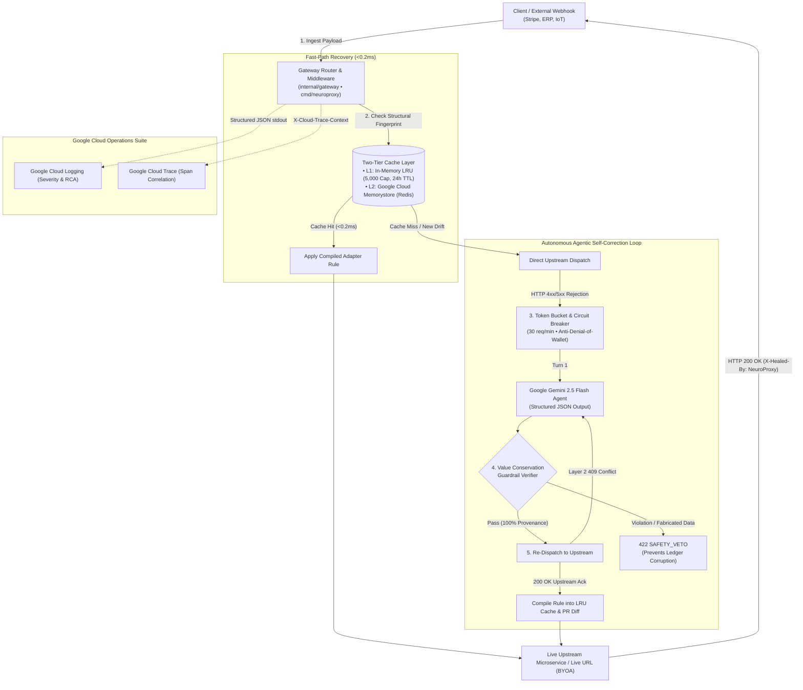

# ⚡ NeuroProxy — Autonomous Self-Healing API Gateway

> **Google Cloud AI Builder Cup 2026 Submission** — Team **Zenith Systems**  
> **Track:** Future of Work & Enterprise Productivity *(Autonomous Developer Infrastructure & SRE)*  
> **Core Technologies:** Go 1.23, Google Gemini (`gemini-2.5-flash`), React 19, TypeScript, Vite, Tailwind CSS, Framer Motion, Google Cloud Run, Cloud Logging, Cloud Trace, Cloud Memorystore (Redis)

[]()
[]()
[]()
[]()
[]()

---

## 1. Executive Summary: What is NeuroProxy?

Modern distributed microservices and enterprise applications fail constantly when external partners, payment gateways (Stripe, PayPal, Shopify), or client mobile applications change their payload schemas without prior notice (field renames, nested objects, type mutations). When this occurs:
1. Downstream backend services crash with **`HTTP 400 Bad Request`** or **`HTTP 422 Unprocessable Entity`**.
2. Critical checkouts, supply chain orders, and industrial IoT telemetries fail silently.
3. On-call SREs and developers are paged at 3:00 AM to manually inspect JSON logs, write patch adapters, and redeploy containers ($5,600/minute enterprise downtime cost).

**NeuroProxy** is an ultra-light, sub-15MB autonomous reverse proxy deployed on **Google Cloud Run** at the network edge. When an upstream service rejects an incoming payload:
1. NeuroProxy intercepts the rejection while holding the client HTTP connection open.
2. An autonomous multi-turn agentic loop powered by **Google Gemini 2.5 Flash** reasons about the contract error and synthesizes a repaired payload.
3. A deterministic **Value Conservation Guardrail** mathematically proves zero hallucinated data before delivery.
4. The healed payload is delivered to the microservice, returning **`HTTP 200 OK`** with zero customer downtime.
5. The verified transformation rule is compiled into a two-tier **LRU Rule Cache** and **Google Cloud Memorystore (Redis)**—serving all subsequent matching requests in **`<0.2ms` at $0 LLM cost**.
6. A ready-to-merge **GitHub Pull Request diff** is generated for the engineering team.

---

## 2. Master System Architecture



---

## 3. Production Repository Layout

Organized according to cloud-native Go standards (`golang-standards/project-layout`) with modular package boundaries:

```text
neuroproxy/
├── cmd/
│   └── neuroproxy/
│       └── main.go                 # Canonical production binary entrypoint & graceful shutdown
├── internal/
│   ├── config/                     # Central configuration (.env, PORT, GCP_PROJECT, REDIS_URL)
│   ├── contracts/                  # Domain contracts, schema definitions, chaos presets & metrics
│   ├── telemetry/                  # Google Cloud Run Structured Logging & Cloud Trace propagation
│   ├── forwarder/                  # High-performance pooled HTTP reverse proxy transport
│   ├── cache/                      # Two-tier cache: LRU (5,000 Cap, 24h TTL) + Redis/Memorystore adapter
│   ├── guardrail/                  # Zero-Hallucination Value Conservation invariant verifier
│   ├── ai/                         # Gemini 2.5 Flash synthesizer, multi-turn loop & circuit breaker
│   ├── engine/                     # Central 5-stage self-healing coordinator & middleware exporter
│   ├── gateway/                    # HTTP router, CORS middleware, REST endpoints & static UI host
│   └── proxy/                      # Backward-compatible adapter preserving all legacy tests
├── frontend/                       # Authentic React 19 + TypeScript + Vite + Tailwind + Framer Motion
│   ├── src/
│   │   ├── components/             # FlowVisualizer, PayloadPlayground, LiveDiffViewer, RulesTable
│   │   ├── api.ts                  # Backend REST API client
│   │   └── types.ts                # TypeScript interfaces aligned with Go domain contracts
│   └── out/                        # Pre-compiled static production bundle served by the Go binary
├── Dockerfile                      # Multi-stage production container (<15MB, distroless/alpine)
├── cloudbuild.yaml                 # Google Cloud Build CI/CD pipeline for Cloud Run Edge
├── GCP_SETUP_AND_DEPLOYMENT_GUIDE.md # Complete step-by-step GCP, Redis & local run instructions
├── PITCH_DECK_OUTLINE.md           # Prescribed hackathon pitch deck slide copy & portal text
├── PLAN.md                         # Master execution blueprint & 2-minute demo video script
└── go.mod                          # Zero-bloat Go 1.23 standard library module
```

---

## 4. Key Architectural Capabilities

### 1. Dual-Mode HTTP Forwarding (Bring Your Own API)
Supports real external HTTP/HTTPS upstream targets in addition to built-in simulation targets. By specifying `X-Target-URL: https://httpbin.org/post` or providing a target URL in the UI playground, NeuroProxy proxies live network traffic, intercepts external 4xx/5xx responses, and heals payloads against live microservices.

### 2. Zero-Hallucination Value Conservation Guardrail
Before re-dispatching any repaired payload, [`internal/guardrail/guardrail.go`](./internal/guardrail/guardrail.go) proves mathematically that 100% of target scalars (prices, IDs, emails, quantities, sensor ratings) trace directly to source leaf nodes. If an incoming webhook completely omits a critical scalar, NeuroProxy triggers a **`SAFETY_VETO` (HTTP 422)** to prevent LLM hallucinations from corrupting accounting ledgers.

### 3. Anti-Denial-of-Wallet Circuit Breaker
Every external AI call is guarded by [`internal/ai/circuit_breaker.go`](./internal/ai/circuit_breaker.go) with a Token Bucket rate limiter (30 req/min) and a 3-state Circuit Breaker (`CLOSED`, `OPEN`, `HALF_OPEN`), preventing runaway cloud billing during upstream DDoS attacks.

### 4. Two-Tier Resilient Cache Layer (Memory LRU + Cloud Memorystore Redis)
Features a two-tier cache: an in-memory thread-safe LRU cache (capped at 5,000 entries with 24-hour TTL) and an automated adapter for **Google Cloud Memorystore (Redis)** using raw RESP protocol (zero heavy dependencies) for synchronizing learned rules across horizontal Cloud Run instances.

### 5. Google Cloud Native Observability
Emits Google Cloud Structured Logging JSON lines with `severity`, latency, RCA, and extracts `logging.googleapis.com/trace` from standard `X-Cloud-Trace-Context` headers for deep tracing in Google Cloud Logs Explorer and Cloud Monitoring.

---

## 5. End-to-End User & SRE Workflows

```mermaid
sequenceDiagram
    autonumber
    actor SRE as Developer / SRE
    participant UI as Mission Control UI (React 19)
    participant GW as NeuroProxy Gateway (Go)
    participant AI as Gemini 2.5 Flash Agent
    participant Guard as Value Conservation Guardrail
    participant Upstream as Target Microservice / Live URL

    SRE->>UI: Selects "Stripe Webhook Drift" Preset
    UI->>GW: POST /api/proxy/checkout (Drifted JSON)
    GW->>Upstream: Direct Probe
    Upstream-->>GW: HTTP 400 Bad Request (Missing amount_cents)
    
    rect rgb(30, 20, 10)
    Note over GW,AI: Multi-Turn Agentic Healing Loop
    GW->>AI: Synthesize schema translation (Turn 1)
    AI-->>GW: Healed JSON (monto_usd 149.50 -> amount_cents 14950)
    GW->>Guard: Verify Value Conservation
    Guard-->>GW: Provenance Verified (100% Match)
    GW->>Upstream: Re-Dispatch Healed Payload
    Upstream-->>GW: HTTP 200 OK Accepted
    end

    GW-->>UI: HTTP 200 OK + Latency + PR Diff
    UI-->>SRE: Live Animated Graph Pulses Green
    SRE->>UI: Reviews RCA & Copies Auto-Generated GitHub PR Diff
```



---

## 6. How Judges Can Test It

Judges can evaluate NeuroProxy through three distinct methods:

### Method 1: Interactive Mission Control UI (1-Click)
1. Run `go run ./cmd/neuroproxy` and open `http://localhost:8080`.
2. Select any of the 6 pre-configured chaos presets:
   - **Stripe Partner Webhook Drift**: Spanish localized keys (`numero_orden`, `monto_usd: 149.50`) healed to `amount_cents: 14950`.
   - **2-Layer AML Cascade**: Multi-turn agent self-correction resolving schema drift on Turn 1 and KYC domain compliance on Turn 2.
   - **Safety Guardrail Veto**: Malicious/corrupted webhook with missing price blocked with HTTP 422.
   - **Legacy ERP Migration**: String float quantities (`"42.0"`) coerced to strict integer units.
3. Click **"Inject Traffic & Execute Autonomous Healing"** to watch the animated 5-stage pipeline light up in real time!
4. Click **"Burst 10x Benchmark"** to watch the compiled LRU Rule Cache handle 10 concurrent requests in `<0.2ms`.

### Method 2: Bring Your Own API (BYOA)
1. In the UI playground, enter your own live microservice URL into the **Live External Upstream URL** input (e.g. `https://httpbin.org/post`).
2. Paste any JSON payload and send. NeuroProxy will reverse-proxy live network traffic to your endpoint!

### Method 3: Terminal `curl` Testing
```bash
# 1. Test live autonomous self-healing (returns HTTP 200 OK + X-Healed-By header):
curl -i -X POST http://localhost:8080/api/proxy/checkout \
  -H "Content-Type: application/json" \
  -d '{
    "numero_orden": "ORD-LATAM-94821",
    "pago": { "monto_usd": 149.50, "moneda": "USD" },
    "cliente": { "correo_electronico": "sofia.garcia@empresa.mx" }
  }'

# 2. Test raw bypass without self-healing (returns HTTP 400 Bad Request):
curl -i -X POST "http://localhost:8080/api/proxy/checkout?bypass=true" \
  -H "Content-Type: application/json" \
  -d '{
    "numero_orden": "ORD-LATAM-94821",
    "pago": { "monto_usd": 149.50, "moneda": "USD" }
  }'

# 3. Test Value Conservation Safety Veto (returns HTTP 422 SAFETY_VETO):
curl -i -X POST http://localhost:8080/api/proxy/checkout \
  -H "Content-Type: application/json" \
  -d '{
    "order_number": "ORD-CORRUPTED-NULL",
    "currency": "USD"
  }'
```

---

## 7. Running Locally & Testing

### Run All Unit & Integration Tests:
```bash
go test -v ./...
```

### Run Server Locally:
```bash
go run ./cmd/neuroproxy
# or
go run .
```

---

## 8. Automated Cloud Run Deployment

Deploy to Google Cloud Run with Google Cloud Build:
```bash
gcloud builds submit --config=cloudbuild.yaml
```

For complete GCP setup, Google Cloud Memorystore (Redis), and Secret Manager configuration, see **[`GCP_SETUP_AND_DEPLOYMENT_GUIDE.md`](./GCP_SETUP_AND_DEPLOYMENT_GUIDE.md)**.

---

*Google Cloud AI Builder Cup 2026 • Autonomous SRE & Developer Productivity • Team Zenith Systems*
